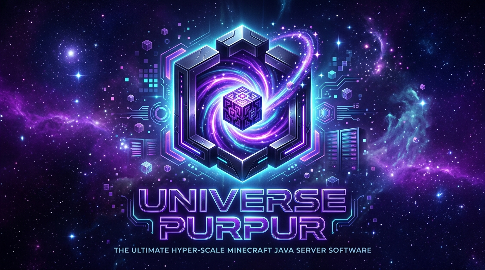

<p align="center">
  
</p>

<div align="center">

# UniversePurpur

### *The Ultimate Hyper-Scale Minecraft Server Software (+15,000 Concurrent Players)*

[](LICENSE)
[](https://www.oracle.com/java/)
[]()
[](https://purpurmc.org)
[](https://github.com/SrJayYT)

**UniversePurpur** es una bifurcación de nivel empresarial de [Purpur](https://purpurmc.org) y [Paper](https://papermc.io), re-arquitecturada desde el núcleo para soportar mega-redes, lobbies masivos, minijuegos de alta concurrencia y clústeres globales con **más de 15,000 jugadores en línea simultáneos**.

[Características](#-características-principales) •
[Presets](#-presets-de-alto-rendimiento) •
[Comandos](#-comandos-administrativos) •
[Inicio Rápido](#-inicio-rápido) •
[Compilación](#-compilación) •
[Licencia](#-licencia)

</div>

---

## ⚡ Características Principales

### 🧠 1. Gobernador Dinámico de MSPT de 5 Niveles
Un motor de mitigación autónomo que monitorea continuamente el MSPT y TPS en tiempo real, aplicando micro-regulaciones progresivas sin intervención de administradores:
- **Nivel 0 (Óptimo, MSPT < 30ms):** Fidelidad completa a 20.0 TPS.
- **Nivel 1 (Soft Throttle, MSPT 30-38ms):** Reducción de ticks cerebrales (DAB) en entidades lejanas.
- **Nivel 2 (Moderate Throttle, MSPT 38-42ms):** Congelamiento de ítems inactivos en el suelo y limitación de física de bloques.
- **Nivel 3 (Aggressive Culling, MSPT 42-46ms):** Restricción de rango de visión y ajuste dinámico de ráfagas de paquetes.
- **Nivel 4 (Hyper-Scale Lockdown, MSPT >= 46ms):** Supresión de paquetes cosméticos y priorización absoluta de hilos de red de jugadores.

### 🌐 2. Particionado Espacial 2D O(1) (`SpatialGrid`)
Reemplaza los escaneos lineales $O(N)$ del servidor con particiones de cuadrícula hash de $32 \times 32$ bloques:
- **Culling Inteligente por Proximidad:** Cada cliente renderiza prioritariamente los 32 jugadores más cercanos alrededor suyo, garantizando que nunca se oculten amigos a 1 bloque de distancia.
- **Aislamiento Multi-Mundo:** Grids independientes indexados por UUID de mundo, eliminando colisiones de coordenadas entre el Overworld, Nether y Arenas.

### 🛡️ 3. Blindaje Anti-Crasher y Protección Zero-Day (`AntiCrashShield`)
Defensa activa en la capa de red contra exploits y paquetes maliciosos:
- Filtrado estricto de vectores de movimiento `NaN` y coordenadas infinitas.
- Bloqueo de rotaciones `yaw/pitch` desbordadas.
- Rechazo de paquetes de canal con payloads NBT mayores a 16 KB.
- Validación de slots de contenedores para evitar caídas por `IndexOutOfBoundsException`.

### 🚦 4. Limitador de Paquetes Lock-Free (`PacketRateLimiter`)
Algoritmo de *Token Bucket* atómico basado en bucles CAS (`compareAndSet`):
- Cero contención de sincronización entre hilos de Netty.
- Recarga proporcional sin deriva ni truncamiento fraccional de micro-tokens.
- Escalado adaptativo automático bajo carga extrema del servidor.

### 🧹 5. Gobernador de Memoria y Auto-Garbage Healer (`UniverseMemoryGovernor`)
- Telemetría en tiempo real del Heap de la JVM y pausas de Garbage Collection.
- Poda preventiva de cachés de mundos y chunks inactivos antes de que ocurran picos de parada de mundo (Stop-The-World).
- Despacho seguro en el hilo principal cumpliendo con las restricciones de `AsyncCatcher` de Paper.

### 💻 6. Portal Web Público y Centro de Control Admin (`UniverseWebPanel`)
UniversePurpur incluye de forma nativa un servidor HTTP embebido de alto rendimiento (puerto predeterminado `25566`) con interfaz moderna de estética dark cosmic/cyberpunk:
- **🌐 Portal Web Público (`/`):**
  - Vista para jugadores con IP copiable al portapapeles en 1 clic.
  - Telemetría en vivo: Conexiones activas, TPS, MSPT y estado del clúster.
  - Formulario interactivo de **Vinculación de Cuentas de Discord** para jugadores.
  - Enlace directo a la comunidad de Discord configurada.
- **🛡️ Centro de Control Admin (`/admin`):**
  - **Login Seguro & Roles:** Autenticación con contraseñas encriptadas con hash SHA-256 + salt y tokens de sesión de 7 días (`universe-users.json`). Roles de `SUPER_ADMIN` y `MODERATOR`.
  - **Gestor Multi-Usuario:** Creación y revocación de cuentas administrativas directamente desde la interfaz web.
  - **Personalizador Dinámico de Marca:** Edición en caliente del título del servidor, descripción, IP pública, logo URL, favicon URL y enlace de Discord con guardado automático en `universe-purpur.yml`.
  - **Gestión Total de Jugadores:** Búsqueda en vivo de jugadores conectados, con acciones instantáneas de expulsar (**Kick**), suspender (**Ban**) o alternar permisos (**OP**) en 1 clic.
  - **Terminal de Consola Remota:** Envía y ejecuta cualquier comando de Minecraft (`/stop`, `/say`, `/give`, `/whitelist`, etc.) directamente desde el navegador.
  - **Mitigación y Telemetría en Vivo:** Monitoreo de TPS, MSPT, memoria RAM Heap, pausas de GC, chunks cacheados, cubos espaciales 2D y paquetes bloqueados por AntiCrash.
  - **Servidor de Assets Locales (`/assets/*`):** Sirve banners y logos localmente sin depender de CDNs externas.

### 🔗 7. Sistema de Vinculación de Cuentas Discord (`UniverseDiscordLinker`)
- **Comando In-Game:** Los jugadores generan un código temporal de 6 dígitos mediante `/link` o `/vincular`.
- **Verificación Web:** Ingresan su código en el portal web público (`/`) junto a su Discord Tag para completar el enlace.
- **Persistencia Segura:** Las vinculaciones se almacenan permanentemente en `universe-discord-links.json`.
- **API REST para Bots de Discord:**
  - `GET /api/discord/lookup?discordId=<id>`: Busca el jugador de Minecraft vinculado a una ID de Discord.
  - `GET /api/discord/lookup?player=<name>`: Busca los datos de Discord vinculados a un jugador.
  - Permite a cualquier bot de Discord sincronizar roles, rangos y verificaciones automáticamente.

---

## 🔌 Arquitectura de Puertos del Servidor

UniversePurpur requiere **2 puertos por defecto** (y un 3er puerto opcional si se utiliza Geyser):

| Puerto | Protocolo | Servicio | Descripción |
| :---: | :---: | :--- | :--- |
| **`25565`** | **TCP** | **Minecraft Java Server** | Puerto principal de conexión para clientes Java de Minecraft. |
| **`25566`** | **TCP / HTTP** | **Web Portal & Admin Panel** | Portal público (`/`) y panel admin (`/admin`) en `http://<ip>:25566`. |
| **`19132`** | **UDP** | **Geyser Bedrock (Opcional)** | Puerto para compatibilidad crossplay con Minecraft Bedrock (móviles, consolas). |

## 🎯 Presets de Alto Rendimiento

En [`universe-purpur.yml`](universe-purpur.yml), UniversePurpur incluye perfiles preconfigurados listos para producción:

| Preset | Caso de Uso | Distancia Simulación | Max Jugadores Visibles | Colisiones |
| :--- | :--- | :---: | :---: | :---: |
| `15k-hyper-hub` | Lobbies principales y Spawns masivos | **2 chunks** | **24** | **0** (Desactivadas) |
| `15k-mega-arena` | Bedwars, Skywars, Duels y Práctica | **3 chunks** | **48** | **1** (Máx 1 empuje) |
| `15k-scale-smp` | Supervivencia masiva y Skyblock | **3 chunks** | **32** | **1** (Máx 1 empuje) |

---

## 🛠️ Comandos Administrativos y de Jugadores

### Comandos del Servidor y Jugadores:
```text
/link (alias: /vincular, /discordlink)
  Genera un código de un solo uso (UP-XXXXXX) válido por 5 minutos para vincular tu cuenta con Discord en el portal web.
```

### Comandos de Diagnóstico y Control Maestro:
El comando maestro `/universespigot` (alias: `/uspigot`, `/universe`) proporciona control total:

```text
/universespigot status
  Muestra el Dashboard en vivo con TPS, MSPT, memoria RAM, nivel del gobernador y métricas de culling.

/universespigot profile <15k-hyper-hub | 15k-mega-arena | 15k-scale-smp>
  Cambia el perfil de rendimiento en caliente sin reiniciar el servidor.

/universespigot lagprotection <on | off | auto>
  Controla el sistema de emergencia de mitigación de lag.

/universespigot purge <items | ambient | monsters>
  Limpia entidades acumuladas instantáneamente en todos los mundos.

/universespigot memory [trim]
  Muestra estadísticas de Garbage Collection y ejecuta poda proactiva de cachés de memoria.

/universespigot shield
  Muestra el total de paquetes maliciosos, vectores NaN y exploits bloqueados.

/universespigot spatial
  Muestra el estado de la cuadrícula de particionado 2D y cubos activos por mundo.

/universespigot reload
  Recarga la configuración de universe-purpur.yml en memoria de forma segura.
```


---

## 🚀 Inicio Rápido

### Banderas Recomendadas de la JVM (Java 24 LTS con Generational ZGC)

UniversePurpur está optimizado para ejecutarse con **Generational ZGC** en servidores con 32 GB a 64 GB de RAM:

#### Windows (`start.bat`):
```bat
java -Xms32G -Xmx32G ^
  -XX:+UseZGC -XX:+ZGenerational ^
  -XX:+AlwaysPreTouch ^
  -XX:+UseNUMA ^
  -Dio.netty.allocator.type=pooled ^
  -jar purpurclip.jar nogui
```

#### Linux (`start.sh`):
```bash
java -Xms48G -Xmx48G \
  -XX:+UseZGC -XX:+ZGenerational \
  -XX:+AlwaysPreTouch \
  -XX:+UseNUMA \
  -Dio.netty.allocator.type=pooled \
  -jar purpurclip.jar nogui
```

---

## 🔨 Compilación

Para compilar UniversePurpur desde el código fuente se requiere **JDK 24** y Git:

```bash
# 1. Clonar el repositorio
git clone https://github.com/SrJayYT/UniversePurpur-.git
cd UniversePurpur-

# 2. Aplicar parches de Paper y Purpur
./gradlew applyAllPatches

# 3. Compilar el JAR ejecutable del servidor
./gradlew createMojmapBundlerJar
```

El archivo JAR generado se encontrará en `purpur-server/build/libs/`.

---

## 📄 Licencia

UniversePurpur está bajo la licencia **MIT License**. Consulta el archivo [LICENSE](LICENSE) para más detalles.

Agradecimientos especiales a los proyectos upstream:
- [PurpurMC/Purpur](https://github.com/PurpurMC/Purpur)
- [PaperMC/Paper](https://github.com/PaperMC/Paper)
- [PaperMC/paperweight](https://github.com/PaperMC/paperweight)

---

<p align="center">
  <b>Desarrollado y optimizado con ❤️ por DevPapo para redes de Minecraft masivas.</b>
</p>
